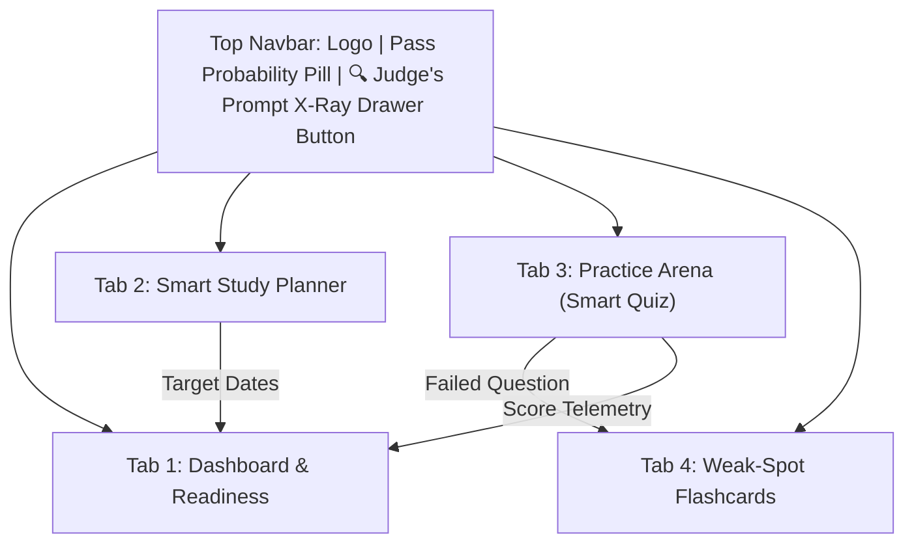

# TutaPass — Technical & Product Specification (SPEC.md)

> **Unofficial Microsoft Azure Fundamentals (AZ-900) Flagship & Universal Exam Preparation Engine**  
> Built for the **Power Learn Project (#1MillionDevs) Vibe Coding Hackathon: AZ-900 Exam Prep Edition**  
> *"Building Smarter Exam Prep Tools from Our Own Learning Journey"*

---

## 1. The 3-Minute Pitch & Problem Statement

Most certification prep fails learners in three ways:
1. **Abstract Jargon**: Cloud concepts feel dry and foreign, disconnected from everyday African realities.
2. **Useless Quiz Feedback**: Typical apps just say *"Wrong! The correct answer is B."* They don't explain **why** the distractor was tempting or **in what scenario that wrong option would actually be right**.
3. **Forgotten Mistakes**: Learners take quizzes, guess, fail questions, and repeat the same mistakes on exam day because there is no automated revision loop.

**TutaPass solves this in a single loop:**
Take a smart quiz $\rightarrow$ dissect every distractor with an instant **Autopsy** $\rightarrow$ switch into **African or Sheng analogies** when stuck $\rightarrow$ let failed questions turn into **Auto-Flashcards** $\rightarrow$ watch your **Exam Readiness** score climb.

> **Disclaimer**: TutaPass is an **independent, unofficial educational prep tool**. It does not replicate proprietary Microsoft exam questions or use Microsoft logos. All questions are dynamically synthesized using the public Microsoft Learn AZ-900 skills outline.

---

## 2. Product Architecture & Navigation



### 2.1 Simple 4-Tab UI Layout (Single-Page Dashboard)
The React frontend uses a clean single-page dashboard with 4 focused tabs, plus the top-navbar **Judge's Prompt X-Ray Drawer**:

* **Tab 1: Dashboard & Readiness**:
  - **Pass Probability Gauge**: Composite 0–100% exam readiness score.
  - **3 Domain Mastery Bars**: Real-time progress across the 3 core AZ-900 domains.
  - **`+ Import Any Syllabus` Modal**: One-click modal to paste any other curriculum (e.g., AWS CLF-C02, CompTIA Security+) and instantly transform it into study modules.
* **Tab 2: Smart Study Planner**:
  - High-impact, minimal input: **Target Exam Date** + **Available Daily Hours**.
  - Generates an actionable, calendar-style daily checklist dynamically weighted to attack the learner's weakest domains first.
* **Tab 3: Practice Arena (Smart Quiz)**:
  - Real-world scenario-based questions with instant feedback.
  - **Distractor Autopsy**: Explains why an option is wrong AND the exact scenario where it *would* be right.
  - **1-Click Context Switcher**: Seamlessly toggle any question or explanation between:
    - `[Standard English]` Official enterprise cloud terminology.
    - `[African Real-Life Analogy]` Relatable parallels (M-Pesa, bodaboda networks, solar grids).
    - `[Sheng Mode]` Nairobi street tech vibes that make complex ideas stick fast.
* **Tab 4: Weak-Spot Flashcards**:
  - Zero manual entry: Automatically harvests questions and concepts the learner missed in the Practice Arena.
  - Built-in SuperMemo-2 (SM-2) spaced repetition intervals (`Forgot`, `Hard`, `Good`, `Easy`) so learners review at the optimal forgetting curve.
* **Top Navbar: Judge's Prompt X-Ray Drawer**:
  - Slide-out side drawer accessible anywhere in the app with one click.
  - Displays the raw AI prompt, injected context, actual model name or fallback status, temperature, and prompt engineering rationale for hackathon judges evaluating the 20% prompt criteria.

---

## 3. Core Features in Detail

### 3.1 Unofficial AZ-900 Flagship + Universal Syllabus Importer
* **AZ-900 Out of the Box**: Pre-loaded with official domain weightings:
  1. *Cloud Concepts* (25–30%)
  2. *Azure Architecture and Services* (35–40%)
  3. *Azure Management and Governance* (30–35%)
* **Universal Importer**: Paste any syllabus outline text $\rightarrow$ Gemini extracts domain names, estimated weights, and generated starter topics.

### 3.2 The "Distractor Autopsy" Engine
Instead of shallow answers, every multiple-choice option provides:
1. **The Verdict**: Clear confirmation why it does not solve this specific scenario.
2. **When WOULD This Be Right?**: The exact situation where this service/concept would be the correct architecture choice.
3. **The Trap**: The classic misconception or keyword trick that traps beginners.

### 3.3 The Cultural Context Switcher
* **Standard English**: Rigorous technical phrasing required for exam day.
* **African Real-Life Analogy**: Translates abstract concepts into familiar systems (e.g., explaining Azure Availability Zones like distributed market stalls or multi-bank clearing).
* **Sheng Tech Mode**: High-energy East African slang that breaks down tension and makes revision memorable.

### 3.4 Auto-Flashcard Coach (SM-2 Spaced Repetition)
* Every incorrect quiz attempt automatically creates or schedules a flashcard.
* Calculates next review date based on rating:
  - `Forgot`: resets interval to 1 day.
  - `Hard` / `Good` / `Easy`: multiplies review intervals using the SM-2 ease factor.

### 3.5 The Judge's Prompt X-Ray Drawer
* Designed specifically for the **Hackathon 20% Prompt Engineering** criterion.
* Allows judges to inspect:
  - System Instructions & Role Definitions.
  - Few-shot examples & JSON output schema enforcement.
  - Negative constraints (strict prohibition of real exam dumps or trademark misuse).
  - Model telemetry: the actual Gemini Flash alias used, or an explicit simulated offline fallback status.

---

## 4. Tech Stack

| Layer | Choice | Why |
|---|---|---|
| **Frontend** | React 18 (Vite) + Tailwind CSS + Lucide React | Blazing fast, responsive single-page dashboard with zero boilerplate |
| **Backend** | Node.js + Express (`server/`) | Lightweight REST API, prompt orchestration, database queries |
| **Database** | PostgreSQL (`pg`) | Reliable relational data for user plans, questions, and flashcard SRS |
| **AI Engine** | Google Gemini (`@google/genai`) | High-speed, structured JSON generation with Flash model fallback |

---

## 5. Simplified PostgreSQL Schema (6 Clean Tables)

To keep development fast and eliminate unnecessary multi-table SQL joins, `topics` is replaced with an indexed `topic_tag VARCHAR(150)` directly on `quiz_questions` and `flashcards`.

```sql
-- 1. Syllabi (AZ-900 Flagship or Imported)
CREATE TABLE syllabi (
    id SERIAL PRIMARY KEY,
    title VARCHAR(255) NOT NULL,
    code VARCHAR(50) DEFAULT 'AZ-900',
    description TEXT,
    is_flagship BOOLEAN DEFAULT false,
    created_at TIMESTAMP DEFAULT CURRENT_TIMESTAMP
);

-- 2. Domains (The high-level syllabus sections & percentage weights)
CREATE TABLE domains (
    id SERIAL PRIMARY KEY,
    syllabus_id INT REFERENCES syllabi(id) ON DELETE CASCADE,
    name VARCHAR(255) NOT NULL,
    weight_min INT NOT NULL,
    weight_max INT NOT NULL,
    description TEXT
);

-- 3. User Study Plans
CREATE TABLE study_plans (
    id SERIAL PRIMARY KEY,
    user_id VARCHAR(100) NOT NULL,
    syllabus_id INT REFERENCES syllabi(id) ON DELETE CASCADE,
    target_exam_date DATE NOT NULL,
    daily_hours NUMERIC(3,1) NOT NULL,
    schedule_data JSONB NOT NULL, -- Daily checklist items and domain focus
    created_at TIMESTAMP DEFAULT CURRENT_TIMESTAMP
);

-- 4. Quiz Questions & Distractor Autopsies
CREATE TABLE quiz_questions (
    id SERIAL PRIMARY KEY,
    domain_id INT REFERENCES domains(id) ON DELETE CASCADE,
    topic_tag VARCHAR(150), -- e.g., 'Availability Zones', 'CapEx vs OpEx'
    scenario TEXT NOT NULL,
    question TEXT NOT NULL,
    options JSONB NOT NULL, -- Array of { id, text, is_correct, autopsy: { why_wrong, right_scenario, trap } }
    context_translations JSONB, -- { standard, african_analogy, sheng }
    difficulty VARCHAR(20) DEFAULT 'medium',
    created_at TIMESTAMP DEFAULT CURRENT_TIMESTAMP
);

-- 5. User Quiz Attempts
CREATE TABLE user_attempts (
    id SERIAL PRIMARY KEY,
    user_id VARCHAR(100) NOT NULL,
    question_id INT REFERENCES quiz_questions(id) ON DELETE CASCADE,
    selected_option_id VARCHAR(10) NOT NULL,
    is_correct BOOLEAN NOT NULL,
    attempted_at TIMESTAMP DEFAULT CURRENT_TIMESTAMP
);

-- 6. Weak-Spot Flashcards (Spaced Repetition)
CREATE TABLE flashcards (
    id SERIAL PRIMARY KEY,
    user_id VARCHAR(100) NOT NULL,
    domain_id INT REFERENCES domains(id) ON DELETE CASCADE,
    topic_tag VARCHAR(150),
    front_prompt TEXT NOT NULL,
    back_explanation TEXT NOT NULL,
    context_notes JSONB, -- { standard, african_analogy, sheng }
    interval_days INT DEFAULT 1,
    repetition_count INT DEFAULT 0,
    ease_factor NUMERIC(3,2) DEFAULT 2.5,
    next_review_at TIMESTAMP DEFAULT CURRENT_TIMESTAMP
);
```

---

## 6. Minimal REST API Endpoints

| Method | Endpoint | Description |
|---|---|---|
| `GET` | `/api/syllabus` | Returns the active syllabus and its 3 domains |
| `POST` | `/api/syllabus/import` | Imports arbitrary curriculum text using Gemini |
| `POST` | `/api/plan/generate` | Generates a daily study schedule based on date and hours |
| `GET` | `/api/quiz/questions` | Retrieves or AI-generates scenario questions with Autopsies |
| `POST` | `/api/quiz/attempt` | Records answer, updates mastery score, auto-creates flashcard if wrong |
| `GET` | `/api/flashcards/due` | Returns cards ready for spaced review today |
| `POST` | `/api/flashcards/:id/review` | Updates review interval and ease factor via SM-2 |
| `GET` | `/api/readiness` | Returns overall pass probability % and per-domain mastery |
| `GET` | `/api/xray/last-prompt` | Telemetry endpoint feeding the Judge's Prompt X-Ray Drawer |

---

## 7. Hackathon Pitch Alignment

* **Learning Value (25%)**: Tackles real retention with the *Distractor Autopsy* and *SM-2 Spaced Repetition*.
* **Prompt Engineering (20%)**: Directly displayed and testable via the *Judge's Prompt X-Ray Drawer*.
* **User Experience & Vibes (15%)**: 4 clean tabs, *Sheng & African Analogy* toggle, zero learning curve.
* **Rapid Prototyping & Execution (15%)**: Clean 6-table schema, streamlined endpoints, fully functional demo.
* **Technical Creativity (15%)**: Automated quiz-miss to flashcard synthesis and live prompt telemetry.
* **Presentation & Documentation (10%)**: Crisp demo flow, clear un-cluttered code, and honest unofficial compliance.

---
*TutaPass — Study Smart, Grasp Deeply, Pass Confidently.*
